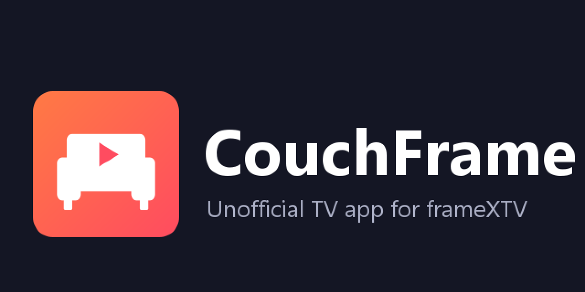

> **Versão personalizada para Google TV — não oficial.** Foi removido o serviço de Acessibilidade e a ponte JavaScript global. A página inicial é `https://framextv.pro/`. A reprodução depende da segurança e disponibilidade de sites terceiros e pode não funcionar com cookies ou HTTP bloqueados. **Não desative o Play Protect.** Para compilar e baixar um APK de teste, abra **Actions → Build TV test APK → última execução → Artifacts**. Consulte [SECURITY.md](SECURITY.md).

<p align="center"></p>

# CouchFrame

**An unofficial Android TV / Google TV app for [frameXTV](https://framextv.cc) that you control with the remote, Netflix-style: no mouse cursor.**

> CouchFrame is not made by, affiliated with, or endorsed by frameXTV. It's a TV-friendly window onto the website: it hosts, stores and streams no video itself, and everything you see comes from the site.

## What it does

- **D-pad navigation.** ←/→ move along a row of posters (the row scrolls with you), ↑/↓ jump between rows, OK opens. The focused poster grows and gets a ring. Going back to a page puts you where you were.
- **Player made for the remote.** The video goes fullscreen when it starts. OK pauses and plays, ←/→ skip 10 s (hold for 30 s), and a progress bar shows the time. ↑ reaches the server switcher, ↓ the player's buttons, and the ⚙ settings and subtitle menus work with the D-pad.
- **Remote media keys.** Play/pause, fast-forward and rewind work.
- **Back does the expected thing.** It closes a menu or dialog, then leaves fullscreen, then goes back a page. Press it twice on the home page to exit.
- **Search with the on-screen keyboard.** Landing on a text box doesn't pop the keyboard up; pressing OK does.
- **Lighter on weak TV boxes.** Off-screen rows aren't drawn, blur effects are off, and analytics and pop-ups are blocked.
- **Optional:** make the remote's **Netflix button open CouchFrame** (see below).

## Install

You need an Android TV / Google TV device (Android 6+). Download **`CouchFrame-x.y.z.apk`** from the [latest release](../../releases/latest), then either:

- **USB stick:** copy the APK to a stick, plug it into the TV, and open it with a file manager. Allow "install unknown apps" for the file manager when asked.
- **Send Files to TV:** use the app of that name on your phone and the TV.
- **adb:** turn on Developer options (Settings → System → About → press *Android TV OS build* 7×), then *USB debugging* or *Wireless debugging*, and run
  ```
  adb connect <tv-ip>:<port>
  adb install CouchFrame-x.y.z.apk
  ```

CouchFrame then shows up on the home screen.

## Netflix button → CouchFrame (optional)

Google TV opens Netflix from that button itself, so CouchFrame needs an accessibility permission to catch it. It only reacts to that one button, reads nothing on screen, and lets every other key through.

Turn it on in **Settings → System → Accessibility → "CouchFrame: Netflix button"**. If the TV greys it out as a "restricted setting" (normal for sideloaded apps), either allow restricted settings for CouchFrame in its app info page, or turn it on over adb:

```
adb shell settings put secure enabled_accessibility_services com.couchframe.tv/com.couchframe.tv.RemoteButtonService
adb shell settings put secure accessibility_enabled 1
```

Notes:
- Force-stopping CouchFrame (Settings → Apps → Force stop) makes Android switch the service off. Turn it back on the same way.
- It's been tested with the Google TV "RemoteG10" remote, which sends `KEYCODE_STEM_1`; other Google TV remotes send `KEYCODE_BUTTON_4`. If your remote sends something else, open an issue.

## Build it yourself

Requirements: Android Studio's bundled JDK (Java 17+, the build uses Gradle 9.1, AGP 8.13 and Kotlin 2.2), plus the Android SDK.

```
./gradlew assembleDebug        # app/build/outputs/apk/debug/app-debug.apk
```

Release builds are signed only when a `keystore.properties` file (`storeFile`, `storePassword`, `keyAlias`, `keyPassword`) exists next to `settings.gradle.kts`. It's git-ignored.

### How it works

- [`MainActivity.kt`](app/src/main/java/com/couchframe/tv/MainActivity.kt) is a full-screen WebView. It blocks pop-ups, redirects off the site, ads and trackers, handles fullscreen video, and routes Back and the media keys.
- [`tv.js`](app/src/main/assets/tv.js) is injected into the page **and every iframe in it**. It does all of the remote control: spatial focus movement, the focus ring, the video "surface" (OK, seek, the progress bar), menus that keep focus while open, and handing focus between the page and the player frame.
- [`RemoteButtonService.kt`](app/src/main/java/com/couchframe/tv/RemoteButtonService.kt) is the Netflix-button remap.

The site is a React app and changes when it's updated. Its `data-testid` attributes are what `tv.js` relies on, so a site redesign can break some of the navigation. Issues and PRs are welcome.

## License

[MIT](LICENSE)
